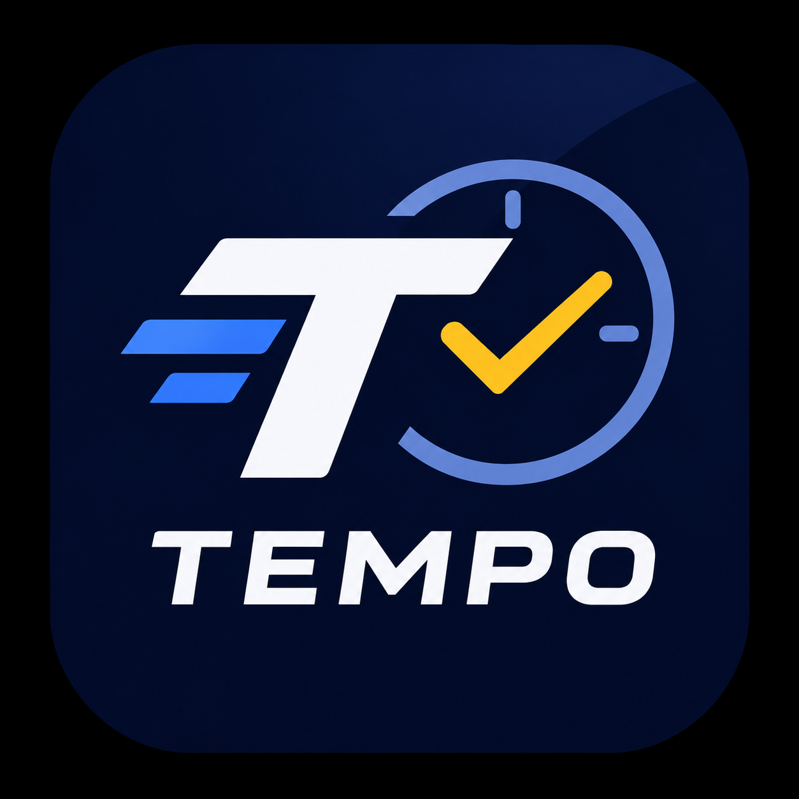

<div align="center">



# TEMPO
### Master your work tempo, never miss a deadline.

*A local-first, high-performance desktop productivity engine featuring unmissable reminders that pierce through Windows Do Not Disturb, Obsidian-style force-directed graph view, markdown logbook journal, global quick scratchpad, and activity vault.*

[](LICENSE)
[](https://github.com/Suruyaa/Tempo)
[](https://www.electronjs.org/)
[](#-privasi--arsitektur-local-first)
[](#-desain--pengalaman-pengguna)

</div>

---

## ⚡ Mengapa TEMPO Dibuat?

Notifikasi bawaan sistem operasi sering kali gagal menyelamatkan tenggat waktu kritis karena tertelan oleh fitur **Windows Focus Assist (Do Not Disturb)**, tertutup game full-screen, atau terabaikan begitu saja. 

**TEMPO** hadir sebagai mesin pengingat agresif dan terstruktur yang menjamin Anda tidak akan pernah melewatkan tugas berprioritas tinggi, sembari tetap menjaga privasi data Anda 100% tersimpan di perangkat lokal tanpa koneksi cloud pihak ketiga.

---

## 🌟 Fitur Utama (Core Features)

### 1. Forced Notification Engine (Bypass Windows Do Not Disturb)
- Memunculkan jendela darurat sekunder berstatus `alwaysOnTop: true, level: 'screen-saver'` di layer teratas layar Anda.
- **Synthesizer Alarm Mandiri**: Bunyi peringatan dinamis dihasilkan secara langsung melalui Web Audio API tanpa memerlukan koneksi internet.
- **Anti-Procrastination Math Challenge**: Untuk tugas berkategori *Mendesak (Urgent)* atau *Hari H*, tombol penunda/penutup alarm dilindungi oleh tantangan perhitungan matematika cepat untuk memaksa otak Anda sadar dan tidak menunda pekerjaan.
- **One-Click Vault Access**: Akses instan ke draft dokumen kerja langsung dari popup notifikasi saat alarm berbunyi.

### 2. Obsidian-Style Force-Directed Graph View
- Visualisasi hubungan prasyarat tugas (**Point A ➜ Point B**) menggunakan simulasi fisika partikel kanvas HTML5 interaktif.
- **Physics Simulation**: Dilengkapi kalkulasi gaya tolak (*repulsion*), pegas elastis (*spring damping*), gravitasi pusat, dan inersia drag-and-bounce.
- **Dual Mode**:
  - **Force Galaxy (Obsidian View)**: Node orbs dinamis dengan glow status (Hijau = Selesai, Cyan = Normal, Kuning = Mendekati Tenggat, Merah = Urgent, Abu-abu = Terkunci).
  - **Timeline Flowchart**: Tata letak berurutan berdasarkan kronologi tenggat waktu.
- **Node Inspector Drawer**: Klik sembarang node untuk memfokuskan kamera, menginspeksi detail, membuka link vault, atau menandai selesai secara real-time.

### 3. Logbook & Jurnal Produktivitas (Markdown Native)
- Ruang pencatatan refleksi harian, evaluasi sprint kerja, dan log pencapaian tugas.
- **Ekspor ke `.MD`**: Kompilasi seluruh entri jurnal dan riwayat tugas selesai ke dalam format standar Markdown untuk diarsipkan di Obsidian, Notion, atau GitHub.
- **Impor dari `.MD`**: Baca kembali berkas Markdown eksternal dan masukkan secara otomatis ke dalam database lokal TEMPO.
- **Auto Milestone Logger**: Setiap tugas yang ditandai selesai otomatis tercatat ke dalam feed pencapaian logbook.

### 4. Quick Scratchpad (Global Shortcut: `Alt + Space`)
- Catat ide kilat, draft teks, atau tautan penting dari aplikasi apa pun di Windows tanpa perlu membuka jendela utama.
- Cukup tekan kombinasi keyboard **`Alt + Space`** atau **`Ctrl + Shift + Space`** untuk memunculkan floating notepad transparan.
- Mendukung fitur **1-Click Convert to Agenda (H-1)** untuk mengubah catatan cepat menjadi agenda resmi.
- Auto-save instan setiap kali Anda mengetik.

### 5. Horizon Peringatan Bertingkat (Countdown H-x)
- Mencegah *panic working* dengan skema peringatan bertahap:
  - **H-7**: Peringatan awal 1 minggu sebelumnya.
  - **H-3 & H-2**: Fase persiapan berkas.
  - **H-1**: Peringatan intensif malam sebelum tenggat.
  - **Hari H & Jam H**: Notifikasi layar penuh tepat waktu.

### 6. Kalender Terintegrasi & Hari Libur Nasional Indonesia (SKB 3 Menteri)
- Memetakan seluruh **Hari Libur Nasional Indonesia (SKB 3 Menteri)** dan Cuti Bersama.
- Memuat **Hari Peringatan Nasional** (Hari Pahlawan, Sumpah Pemuda, Hari Guru, dll) serta **Hari Peringatan Internasional**.
- Agenda pribadi dipetakan langsung berdampingan dengan tanggal merah, memudahkan mitigasi deadline yang berbenturan dengan libur panjang.
- Ekspor kalender ke format **`.ICS`** standar untuk disinkronkan ke Google Calendar atau kalender ponsel Anda.

### 7. Activity Vault (Brankas Berkas & Dokumen)
- Brankas berkas per agenda untuk mengaitkan draft lokal (PDF, Word, Excel, source code) serta tautan dokumen online (Google Docs, Figma, PRD).
- Terintegrasi langsung dengan notifikasi layar paksa untuk pembukaan berkas satu ketukan.

### 8. Mini Desktop HUD
- Widget mengambang transparan di sudut layar desktop (`alwaysOnTop: true, level: 'floating'`).
- Memantau countdown agenda terdekat dan rasio penyelesaian tugas tanpa memakan ruang layar kerja.

---

## 🎨 Desain & Pengalaman Pengguna

- **100% SVG Vector Iconography**: Bebas dari emotikon bergaya "AI slop". Seluruh elemen navigasi, status bar, kartu tugas, dan tombol aksi menggunakan icon vektor yang tajam, presisi, dan konsisten.
- **Custom In-App Dark Dialogs**: Tidak ada lagi dialog browser putih bawaan (`confirm()` / `alert()`). Seluruh konfirmasi aksi menggunakan modal bernuansa gelap dengan aksen crimson dan cyan glow yang serasi.
- **Responsive Sidebar Architecture**: Navigasi menyamping modular yang fleksibel saat jendela di-maximize atau diubah ukurannya.

---

## 🔒 Privasi & Arsitektur Local-First

- **Zero Cloud & Zero Telemetry**: Tidak ada API eksternal yang melacak aktivitas Anda.
- **Penyimpanan Lokal**: Seluruh agenda, catatan scratchpad, berkas vault, dan jurnal logbook tersimpan murni di sistem berkas lokal Anda (`data/activities.json`, `data/logbook.json`, `data/vault/`).
- **Git Friendly**: Berkas rahasia dan vault pribadi secara otomatis dimasukkan ke `.gitignore` sehingga Anda bebas meng-push source code ke GitHub publik tanpa khawatir data pribadi bocor.

---

## ⌨️ Pintasan Keyboard Global (Shortcuts)

| Pintasan Keyboard | Aksi |
| :--- | :--- |
| **`Alt + Space`** | Buka / Tutup Quick Scratchpad di mana saja |
| **`Ctrl + Shift + Space`** | Pintasan alternatif untuk Quick Scratchpad |
| **`Esc`** | Menutup modal atau jendela popup aktif |

---

## 🚀 Panduan Memulai (Quick Start)

### Prasyarat
- [Node.js](https://nodejs.org/) (versi 18 atau lebih baru disarankan)
- npm (terpasang bersama Node.js)
- Git

### 1. Clone Repositori
```bash
git clone https://github.com/Suruyaa/Tempo.git
cd Tempo
```

### 2. Instalasi Dependensi
```bash
npm install
```

### 3. Menjalankan Aplikasi
```bash
npm start
```

---

## 📦 Membuat File Installer Windows (`.exe`)

TEMPO telah dikonfigurasikan menggunakan `electron-builder` untuk menghasilkan installer resmi Windows yang siap pakai:

```bash
# Membuat installer NSIS dan versi Portable
npm run dist
```

Hasil kompilasi akan otomatis tersedia di direktori `dist/`:
- `dist/Tempo Setup 1.0.0.exe` — File installer resmi Windows dengan wizard instalasi dan desktop shortcut.
- `dist/Tempo 1.0.0.exe` — Versi Portable siap pakai tanpa perlu proses instalasi.

---

## 📁 Struktur Repositori

```text
Tempo/
├── assets/                       # Asset icon resmi Tempo Clockmark
├── data/
│   ├── activities.json           # Database lokal agenda & tenggat waktu
│   ├── holidays.json             # Database Hari Libur SKB 3 Menteri & Hari Besar
│   ├── logbook.json              # Database catatan jurnal refleksi
│   └── vault/                    # Folder penyimpanan berkas terlampir
├── src/
│   ├── main/
│   │   ├── alertManager.js       # Window manager untuk notifikasi paksa screen-saver
│   │   ├── icsExporter.js        # Generator ekspor kalender standar RFC 5545
│   │   ├── scheduler.js          # Background cron checker interval H-x
│   │   └── store.js              # Local storage JSON engine & MD parser
│   └── renderer/
│       ├── assets/               # Gambar logo Clockmark dan vector
│       ├── components/
│       │   ├── agendaView.js     # Tampilan to-do list, filter, dan countdown cards
│       │   ├── calendarView.js   # Kalender bulanan, libur nasional & perencana
│       │   ├── logbookView.js    # Editor jurnal & ekspor/impor Markdown
│       │   ├── nodeGraph.js      # Obsidian-style force-directed physics graph
│       │   └── vaultView.js      # Brankas berkas & tautan online
│       ├── alert.html / alert.js # Antarmuka peringatan darurat anti-procrastination
│       ├── scratchpad.html / js  # Floating quick notes widget
│       ├── widget.html / widget.js# Mini HUD desktop
│       ├── index.html            # Layout utama aplikasi
│       ├── index.js              # State manager & controller
│       └── styles.css            # Dark mode glassmorphism design system
├── main.js                       # Electron lifecycle, tray, & global shortcuts
├── preload.js                    # Secure context-bridge IPC
├── package.json                  # Konfigurasi builder & dependensi
└── LICENSE                       # MIT License
```

---

## 📜 Lisensi

Proyek ini dilisensikan di bawah naungan **[MIT License](LICENSE)**. Bebas dikembangkan, dimodifikasi, dan didistribusikan untuk keperluan personal maupun profesional.
